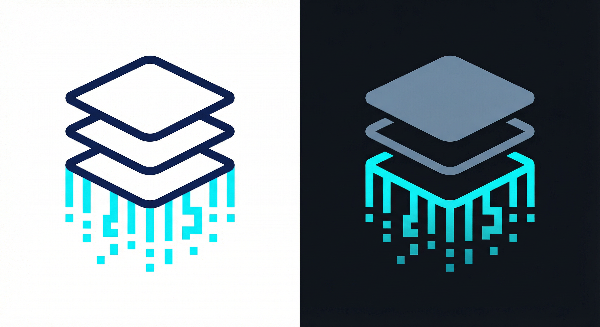

<p align="center">
  
</p>

<h3 align="center">ai-deepresearch-flow</h3>

<p align="center">
  <em>From documents to deep research insight — automatically.</em>
</p>

<p align="center">
  <a href="README.md">English</a> | <a href="README_ZH.md">中文</a>
</p>

<p align="center">
  <a href="https://github.com/nerdneilsfield/ai-deepresearch-flow/actions">
    
  </a>
  <a href="https://pypi.org/project/deepresearch-flow/">
    
  </a>
  <a href="https://pypi.org/project/deepresearch-flow/">
    
  </a>
  <a href="https://hub.docker.com/r/nerdneils/deepresearch-flow">
    
  </a>
  <a href="https://github.com/nerdneilsfield/ai-deepresearch-flow/pkgs/container/deepresearch-flow">
    
  </a>
  <a href="https://github.com/nerdneilsfield/ai-deepresearch-flow/blob/main/LICENSE">
    
  </a>
  <a href="https://github.com/nerdneilsfield/ai-deepresearch-flow/stargazers">
    
  </a>
  <a href="https://pypi.org/project/deepresearch-flow">
    
  </a>
  <a href="https://github.com/nerdneilsfield/ai-deepresearch-flow/issues">
    
  </a>
</p>

---

## Core Pain Points

- **OCR Chaos**: Raw markdown from OCR tools is often broken — tables drift, formulas break, references are non-clickable.
- **Translation Nightmares**: Translating technical papers often destroys code blocks, LaTeX formulas, and table structures.
- **Information Overload**: Extracting structured insights (authors, venues, summaries) from hundreds of PDFs manually is impossible.
- **Context Switching**: Managing PDFs, summaries, and translations in different windows kills focus.

## Solution

DeepResearch Flow provides a unified pipeline to **Repair**, **Translate**, **Extract**, and **Serve** your research library.

## Key Features

- **Smart Extraction** — Turn unstructured Markdown into schema-enforced JSON (summaries, metadata, Q&A) using LLMs.
- **Precision Translation** — Translate OCR Markdown to Chinese/Japanese while freezing formulas, code, tables, and references.
- **Local Knowledge DB** — Web UI with Split View (Source/Translation/Summary), full-text search, and multi-dimensional filtering.
- **Snapshot + API Serve** — Production-ready SQLite snapshot with static assets and read-only JSON API.
- **OCR Post-Processing** — Fix broken references, merge split paragraphs, repair LaTeX and Mermaid diagrams.
- **Semantic Search** — LanceDB-backed vector search with hybrid recall and cloud reranking.
- **MCP Integration** — FastMCP server for AI agent access with bounded read tools, static-bearer Streamable HTTP/SSE, and GitHub OAuth at `/oauth/mcp`.

---

## Quick Start

### 1) Installation

```bash
uv pip install deepresearch-flow
# or: pip install deepresearch-flow
```

### 2) Configuration

```bash
cp config.example.toml config.toml
```

Minimal config with weighted multi-provider routing:

```toml
main_model = [
  { model = "openai/gpt-4o-mini", weight = 4 },
  { model = "claude/claude-sonnet-4-5-20250929", weight = 1 }
]

[[providers]]
name = "openai"
type = "openai_compatible"
base = [
  { url = "https://api.openai.com/v1", weight = 1, key = [
    { value = "env:OPENAI_API_KEY", weight = 4 }
  ] }
]
models = [
  { model_name = "gpt-4o-mini", is_support_json_schema = true }
]

[[providers]]
name = "claude"
type = "claude"
base = [
  { url = "https://api.anthropic.com", weight = 1, key = [
    { value = "env:ANTHROPIC_API_KEY", weight = 1 }
  ] }
]
models = [
  { model_name = "claude-sonnet-4-5-20250929" }
]
```

Keys use `env:VAR_NAME` syntax to keep secrets out of config files. Multiple providers (Ollama, Gemini, DashScope, Azure OpenAI) are supported. For full configuration options (embedding, rerank, translator defaults, search), see `config.example.toml`.

### 3) Process a batch of PDFs

Prepare a project directory that holds `pdf/` and exactly one `.bib` file, then generate and run `run.sh`:

```bash
mkdir myproj
cp -r /path/to/pdfs myproj/pdf
cp /path/to/library.bib myproj/

cp ocr.example.toml ocr.toml     # fill in the OCR backend token
uv run deepresearch-flow utils init-run ./myproj
```

Open `myproj/run.sh` and replace each `--model PROVIDER/MODEL` with a `provider/model` declared in `config.toml`. Different steps can use different models. Then run:

```bash
./myproj/run.sh
```

The script runs OCR, formula and format repair, structured summary extraction, and translation, and finally builds the snapshot database in `myproj/dist/`. Failed items are retried automatically, and a rerun after an interruption resumes at the failed step. For details, see [From PDFs to a snapshot](docs/en/pipeline.md).

### 4) Browse the result

After `run.sh` finishes, open the local web UI:

```bash
uv run deepresearch-flow paper db serve \
  --input myproj/deep_read.json \
  --bibtex myproj/library.bib \
  --md-root myproj/md_simple \
  --md-translated-root myproj/md_base64_translated \
  --pdf-root myproj/pdf
```

To deploy the snapshot and static assets in production, see the [Deployment Guide](docs/en/deployment.md).

---

## Documentation

| Document | Content |
|---|---|
| [From PDFs to a snapshot](docs/en/pipeline.md) | Process one project with `run.sh`: steps, retries, exit codes, notifications |
| [Advanced workflows](docs/en/workflow.md) | Incremental builds, merging, supplementing templates and translations for existing data |
| [Reference](docs/en/reference.md) | Translator, Extract, Recognize, semantic search, exit codes, `init-run` options |
| [Snapshot management](docs/en/snapshot-management.md) | Migrate, supplement, and update snapshots |
| [Deployment guide](docs/en/deployment.md) | CDN, Nginx/Caddy, Docker, Compose, admin pipeline |
| [API and MCP](docs/en/api-and-mcp.md) | Admin API, push, MCP endpoints, auth, and tools |

---

<p align="center">
  Built with love for the Open Science community.
</p>
