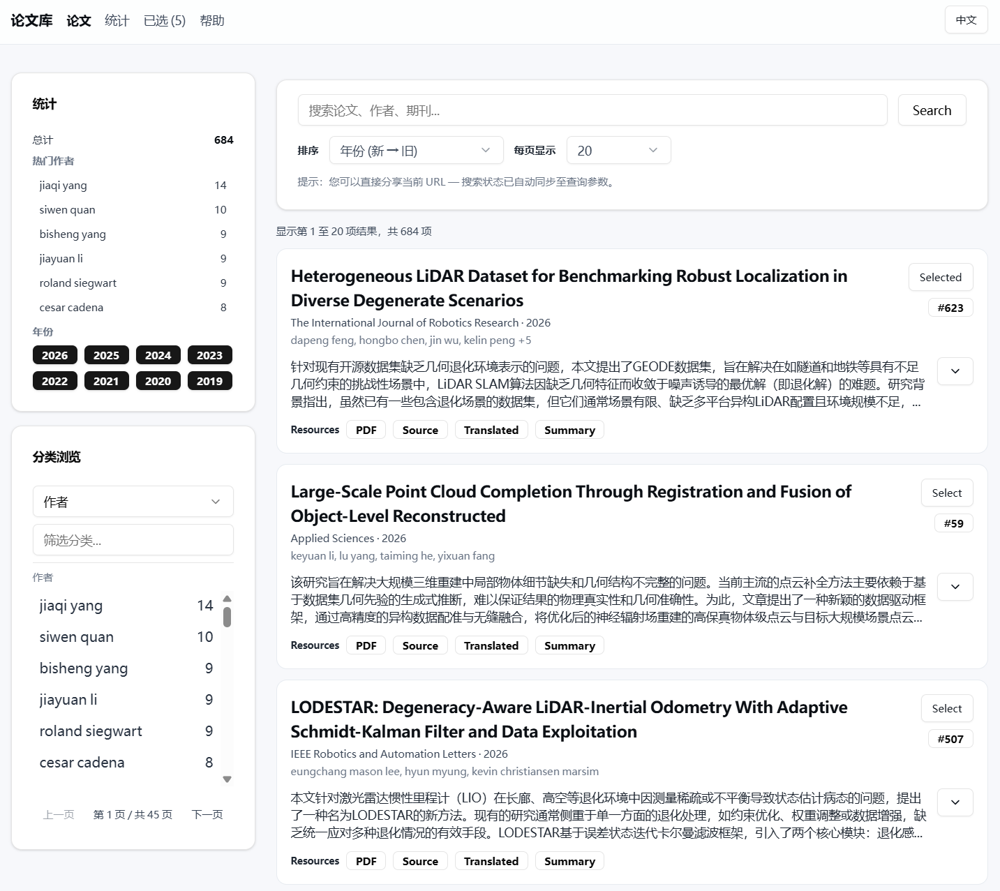

[← Back to README](../../README.md)

# Deployment

The recommended production setup is **front/back separation**:

- **Static CDN** hosts PDFs/Markdown/images/summaries.
- **API server** serves a read-only snapshot DB.
- **Frontend** is a separate static app (Vite build or any static host).

<p align="center">
  
</p>

## Prerequisites

- Python 3.10+ with `uv`
- Node.js 18+ (for frontend build)
- Caddy or Nginx (for reverse proxy / static serving)
- Docker (optional, for containerized deployment)

---

## 1. Build Snapshot + Static Export

Run this after the flow in [From PDFs to a snapshot](pipeline.md) has produced repaired summary JSON, `md_simple/`, and `md_base64_translated/`. The `build` step of `run.sh` already runs the same command; use this one to rebuild on another machine or to change parameters. No existing snapshot database is required. The build host must be able to read the original PDF and Markdown roots. The CDN only needs the exported directory.

```bash
uv run deepresearch-flow paper db snapshot build \
  --input ./deep_read.json \
  --bibtex ./papers.bib \
  --md-root ./md_simple \
  --md-translated-root ./md_base64_translated \
  --pdf-root ./pdf \
  --output-db ./dist/paper_snapshot.db \
  --static-export-dir /data/paper-static
```

Notes:

- Add one `--input ./<template>.json` for each additional repaired
  summary template.
- `--pdf-root` should point to the directory containing original PDF files, which is `pdf/` in the project.
- `--md-root` / `--md-translated-root` should point to `md_simple/` and
  `md_base64_translated/`, respectively.
- `--static-export-dir` is the output directory for static assets. Copy or mount this to your CDN.

---

## 2. Serve Static Assets

Static assets must be served with CORS headers and long-lived cache headers so the frontend can load them cross-origin.

### 2.1 Caddy

```caddyfile
:8002 {
  root * /data/paper-static
  encode zstd gzip

  @static path /pdf/* /md/* /md_translate/* /images/*
  header @static {
    Access-Control-Allow-Origin *
    Access-Control-Allow-Methods GET,HEAD,OPTIONS
    Access-Control-Allow-Headers *
    Cache-Control "public, max-age=31536000, immutable"
  }

  @options method OPTIONS
  respond @options 204

  file_server
}
```

### 2.2 Nginx (API + Frontend on One Domain, Static on Another)

```nginx
# Frontend + API (same domain)
server {
  listen 80;
  server_name frontend.example.com;

  root /var/www/paper-frontend;
  index index.html;

  location / {
    try_files $uri /index.html;
  }

  location /api/ {
    proxy_pass http://127.0.0.1:8001;
    proxy_set_header Host $host;
    proxy_set_header X-Real-IP $remote_addr;
    proxy_set_header X-Forwarded-For $proxy_add_x_forwarded_for;
  }

  # Static-bearer MCP Streamable HTTP
  location ^~ /mcp {
    proxy_pass http://127.0.0.1:8001;
    proxy_set_header Host $host;
    proxy_set_header X-Real-IP $remote_addr;
    proxy_set_header X-Forwarded-For $proxy_add_x_forwarded_for;
    proxy_set_header X-Forwarded-Proto $scheme;
  }

  # Static-bearer SSE transport for MCP clients that require Server-Sent Events
  location ^~ /mcp-sse {
    proxy_pass http://127.0.0.1:8001;
    proxy_http_version 1.1;
    proxy_set_header Connection "";
    proxy_set_header Host $host;
    proxy_set_header X-Real-IP $remote_addr;
    proxy_set_header X-Forwarded-For $proxy_add_x_forwarded_for;
    proxy_set_header X-Forwarded-Proto $scheme;
    proxy_buffering off;
    proxy_cache off;
    proxy_read_timeout 3600s;
    proxy_send_timeout 3600s;
    chunked_transfer_encoding off;
    add_header X-Accel-Buffering no;
  }

  # OAuth MCP Streamable HTTP and OAuth protocol/discovery routes.
  # /oauth/mcp-sse is currently absent/unsupported; do not proxy it unless a future gate adds it.
  location = /oauth/mcp {
    proxy_pass http://127.0.0.1:8001;
    proxy_set_header Host $host;
    proxy_set_header X-Real-IP $remote_addr;
    proxy_set_header X-Forwarded-For $proxy_add_x_forwarded_for;
    proxy_set_header X-Forwarded-Proto $scheme;
  }

  location ^~ /.well-known/ {
    proxy_pass http://127.0.0.1:8001;
    proxy_set_header Host $host;
    proxy_set_header X-Real-IP $remote_addr;
    proxy_set_header X-Forwarded-For $proxy_add_x_forwarded_for;
    proxy_set_header X-Forwarded-Proto $scheme;
  }

  location ~ ^/(authorize|token|register|auth/callback|consent)$ {
    proxy_pass http://127.0.0.1:8001;
    proxy_set_header Host $host;
    proxy_set_header X-Real-IP $remote_addr;
    proxy_set_header X-Forwarded-For $proxy_add_x_forwarded_for;
    proxy_set_header X-Forwarded-Proto $scheme;
  }
}

# Static assets (separate domain)
server {
  listen 80;
  server_name static.example.com;

  root /data/paper-static;

  location / {
    add_header Access-Control-Allow-Origin *;
    add_header Access-Control-Allow-Methods "GET,HEAD,OPTIONS";
    add_header Access-Control-Allow-Headers "*";
    add_header Cache-Control "public, max-age=31536000, immutable";
    try_files $uri =404;
  }
}
```

---

## 3. Start the API Server

Set the `PAPER_DB_STATIC_BASE_URL` environment variable so the API can generate correct URLs pointing to your static CDN.

```bash
export PAPER_DB_STATIC_BASE_URL="https://static.example.com"
```

### 3.1 Basic Mode (No Advanced Search)

```bash
uv run deepresearch-flow paper db api serve \
  --snapshot-db /data/paper_snapshot.db \
  --cors-origin https://frontend.example.com \
  --host 0.0.0.0 --port 8001
```

### 3.2 Advanced Search Mode

Enable semantic search by providing an embedding database and search config.

```bash
SEARCH_ACCESS_TOKEN=your-token \
uv run deepresearch-flow paper db api serve \
  --snapshot-db /data/paper_snapshot.db \
  --embed-db /data/paper_vectors \
  --config ./config.toml \
  --cors-origin https://frontend.example.com \
  --host 0.0.0.0 --port 8001
```

Or via `config.toml`:

```toml
[search]
advanced_enabled = true
vector_dir = "/data/paper_vectors"
access_token = "env:SEARCH_ACCESS_TOKEN"
```

Then:

```bash
SEARCH_ACCESS_TOKEN=your-token uv run deepresearch-flow paper db api serve \
  --snapshot-db /data/paper_snapshot.db \
  --config ./config.toml \
  --cors-origin https://frontend.example.com \
  --host 0.0.0.0 --port 8001
```

Advanced search supports `SEARCH_AUTH_MODE=static`, `github-oauth`, or `both` (default: `static`).
To offer GitHub sign-in in the browser while retaining bearer-token clients:

```bash
SEARCH_AUTH_MODE=both \
SEARCH_ACCESS_TOKEN=your-token \
MCP_PUBLIC_BASE_URL=https://papers.example.com \
GITHUB_OAUTH_CLIENT_ID=... \
GITHUB_OAUTH_CLIENT_SECRET=... \
MCP_GITHUB_ALLOWED_USER_IDS=12345678 \
uv run deepresearch-flow paper db api serve \
  --snapshot-db /data/paper_snapshot.db \
  --config ./config.toml \
  --host 0.0.0.0 --port 8001
```

The browser session lasts seven days and is stored in an HttpOnly cookie. Configure the reused
GitHub OAuth App callback as `https://papers.example.com/auth/callback`; the browser flow uses its
allowed subpath `/auth/callback/web`. GitHub users outside the numeric ID allowlist are rejected.

Deploy the frontend and API on the same origin when possible. For a cross-origin deployment,
the default CORS wildcard (`*`) does not permit credentialed browser requests and the OAuth session
cookie will not authenticate semantic-search fetches. Explicitly allow the frontend origin, for
example `--cors-origin https://frontend.example.com`, and keep frontend requests configured with
`credentials: include` (the bundled frontend already does this). `MCP_PUBLIC_BASE_URL` must be the
public HTTPS origin through which the browser reaches the API and OAuth callback.

### 3.3 API Endpoints

**BibTeX metadata**

```
GET /api/v1/papers/{paper_id}/bibtex
```

| Response field | Type   | Description                    |
|---------------|--------|--------------------------------|
| `paper_id`    | string | Paper ID                       |
| `doi`         | string | DOI (if available)             |
| `bibtex_raw`  | string | Raw BibTeX entry               |
| `bibtex_key`  | string | BibTeX citation key            |
| `entry_type`  | string | Entry type (article, inproceedings, etc.) |

Error responses: `paper_not_found`, `bibtex_not_found`

> For Admin API and MCP endpoint details, see [API and MCP](api-and-mcp.md).

---

## 4. Frontend

The frontend is a Vite-based static app.

```bash
cd frontend
npm install
npm run dev   # with env vars
npm run build # with env vars
```

**Environment variables:**

| Variable                    | Description                          |
|----------------------------|--------------------------------------|
| `VITE_PAPER_DB_API_BASE`   | Base URL of the API server           |
| `VITE_PAPER_DB_STATIC_BASE`| Base URL of the static asset CDN     |

After `npm run build`, deploy the `frontend/dist/` directory to any static host (Nginx, Caddy, Vercel, Netlify, etc.).

---

## Upgrading to incremental push

`api push` now fetches the remote manifest first and pushes only what is missing. Upgrade in this order:

1. Upgrade the server image first, then push with the new client. An old server has no manifest endpoint; the new client fails with an error telling you to upgrade the server.
2. After upgrading, run one full facet_edge recompute. It is safe while the service is running: the command works inside a `BEGIN IMMEDIATE` transaction, so during a push it waits for the lock for up to 30 seconds.

   ```bash
   docker exec <container> deepresearch-flow paper db snapshot recompute --snapshot-db /db/papers.db
   ```

   It recomputes paper_index, the facet counts and facet_edge in turn, then prints the paper count and the facet_edge row count.

3. Intranet access: set `PAPER_DB_BIND_ADDR=[IP]` (or the host's LAN IP) and keep `MCP_PUBLIC_BASE_URL` set to the public https domain. GitHub OAuth does not work when you reach the service through the intranet IP; the static token does. See 5.3 for the other bind-address and CORS notes.

## 5. Docker

Pre-built images are available on both Docker Hub and GitHub Container Registry:

- `nerdneils/deepresearch-flow:latest` — CLI and API image
- `nerdneilsfield/deepresearch-flow:deploy-latest` — Deployment image (API + Nginx frontend)

### 5.1 Run the CLI

```bash
docker run --rm -v $(pwd):/app -it ghcr.io/nerdneilsfield/deepresearch-flow:latest --help
```

### 5.2 Deploy (API + Frontend via Nginx)

**Basic mode:**

```bash
docker run --rm -p 127.0.0.1:8899:8899 \
  -v $(pwd)/paper_snapshot.db:/db/papers.db \
  -v $(pwd)/paper-static:/static \
  -e MCP_ACCESS_TOKEN="$(openssl rand -hex 32)" \
  ghcr.io/nerdneilsfield/deepresearch-flow:deploy-latest
```

**Advanced search (embedded vectors):**

```bash
docker run --rm -p 127.0.0.1:8899:8899 \
  -v $(pwd)/paper_snapshot.db:/db/papers.db \
  -v $(pwd)/paper-static:/static \
  -v $(pwd)/paper_vectors:/db/paper_vectors \
  -v $(pwd)/config.toml:/app/config.toml:ro \
  -e PAPER_DB_EMBED_DB=/db/paper_vectors \
  -e PAPER_DB_CONFIG=/app/config.toml \
  -e SEARCH_ACCESS_TOKEN="$(openssl rand -hex 32)" \
  -e MCP_ACCESS_TOKEN="$(openssl rand -hex 32)" \
  ghcr.io/nerdneilsfield/deepresearch-flow:deploy-latest
```

**External static assets (no local static mount):**

```bash
docker run --rm -p 127.0.0.1:8899:8899 \
  -v $(pwd)/paper_snapshot.db:/db/papers.db \
  -e PAPER_DB_STATIC_BASE=https://static.example.com \
  -e MCP_ACCESS_TOKEN="$(openssl rand -hex 32)" \
  ghcr.io/nerdneilsfield/deepresearch-flow:deploy-latest
```

### 5.3 Docker Compose

Four profiles are available to match different deployment scenarios.

```bash
export MCP_ACCESS_TOKEN="$(openssl rand -hex 32)"
export SEARCH_ACCESS_TOKEN="$(openssl rand -hex 32)"
docker compose -f scripts/docker/docker-compose.example.yml --profile local-static up
```

| Profile                     | Static Assets | Advanced Search |
|----------------------------|---------------|-----------------|
| `local-static`             | Local mount   | No              |
| `external-static`          | External URL  | No              |
| `local-static-advanced`    | Local mount   | Yes             |
| `external-static-advanced` | External URL  | Yes             |

**Runtime notes:**

- Nginx listens on `8899`, proxies `/api`, static-bearer MCP (`/mcp`, `/mcp-sse`), OAuth MCP (`/oauth/mcp`), and OAuth discovery/protocol routes (`/.well-known/`, `/authorize`, `/token`, `/register`, `/auth/callback`, `/consent`) to internal API at `127.0.0.1:8000`. OAuth SSE `/oauth/mcp-sse` is currently absent/unsupported.
- Mount snapshot DB to `/db/papers.db`, static assets to `/static`.
- `start-api.sh` auto-detects advanced mode by checking whether `PAPER_DB_EMBED_DB`, `PAPER_DB_CONFIG`, and `SEARCH_ACCESS_TOKEN` are set.
- The compose example binds to loopback only (`127.0.0.1:8080`) by default. To reach it from the intranet, set `PAPER_DB_BIND_ADDR` (for example `PAPER_DB_BIND_ADDR=0.0.0.0`, or the host's LAN IP). If you also set a restricted `PAPER_DB_CORS_ORIGINS`, add the origin used for intranet access (for example `http://192.168.1.10:8080`), otherwise CORS preflight requests return 400.
- Set `MCP_ACCESS_TOKEN` before deploying. `MCP_PUBLIC_UNSAFE=1` is intended for isolated local testing only.
- `PAPER_DB_NGINX_TEMPLATE=prefix` is only needed for sub-path deployments. The default (`root`) works for dedicated domains.

### 5.4 Import locally built data into a running container

Instead of a remote push, you can copy (or mount) a local snapshot DB and embed DB into the container and import them incrementally into the databases the service is using, `/db/papers.db` and `/db/paper_vectors`. The service can keep running during the import: semantic writes take an exclusive lock file (`<embed-db>/.write.lock`) shared with the server's own semantic writes, so they queue behind each other.

```bash
docker cp ./dist/paper_snapshot.db <container>:/tmp/import.db
docker cp ./dist/paper_vectors <container>:/tmp/import_vectors

docker exec <container> deepresearch-flow paper db api import-local \
  --from-snapshot-db /tmp/import.db \
  --from-embed-db /tmp/import_vectors \
  --snapshot-db /db/papers.db \
  --embed-db /db/paper_vectors
```

- Target paths default to the `PAPER_DB_SNAPSHOT_DB` and `PAPER_DB_EMBED_DB` environment variables. The target snapshot DB must already exist (a wrong path is an error, not a new database); a missing `--embed-db` directory is created with a notice. Omit `--embed-db` and `--from-embed-db` to import papers only.
- Reconciliation matches `api push`: only papers missing from the target are imported, and with `--overwrite` papers whose `source_hash` differs are replaced too. Without `--overwrite`, only semantic groups missing from the target are written; with `--overwrite`, groups whose `{id: content_hash}` fingerprint differs are replaced too, so paper versions and vectors stay consistent.
- Papers are written one transaction per 200 papers, so the write lock is never held for long; the service's own writes wait at most 30 seconds.
- Re-entrant: running it again writes nothing and does not optimize. When semantic groups were written, it optimizes before exiting.
- If the source `index_meta.json` is missing or incomplete, or the target embed DB's model or dimensions differ from the source (the vector column length is checked when the target has a table but no `index_meta.json`), the command exits with an error before writing any paper.
- This path writes incrementally, so no full facet_edge recompute is needed afterwards.
- Do not run a remote push at the same time: paper writes of the two are not coordinated.
- Static assets are not imported; put them in `/static` or push them to the external static storage separately.

## 6. Optional: Admin PDF pipeline

The Admin PDF pipeline lets an administrator upload PDFs in the web UI, review them, and publish them to the snapshot. It is off by default. To enable it, both conditions must hold: `[pipeline].enabled = true` in `config.toml`, and the environment variable `PAPER_PIPELINE_ENABLED=1`. If the two disagree, the service refuses to start.

### 6.1 Configuration

Add a `[pipeline]` section to `config.toml`:

```toml
[pipeline]
enabled = true
work_dir = "/data/pipeline-work/work"
preview_root = "/data/pipeline-work/previews"
queue_db = "/data/pipeline-work/queue.sqlite3"
snapshot_db = "/db/papers.db"
static_root = "/static"
formal_gc_batch_size = 100
formal_gc_grace_seconds = 86400
```

`config.example.toml` has a commented full example. It covers upload limits, the OCR/Extract/Translate model allowlists and defaults, the fixed extract template, the translation language, lease and heartbeat, retries, retention, and the fingerprints of supporting models. A selected model must be in its allowlist.

The queue stores only nonsecret model identifiers, paths, endpoints, and configuration fingerprints. Provide provider keys and WebDAV passwords through environment variables or container secrets. Do not put them in the TOML file.

### 6.2 Start with the deployment image

```bash
mkdir -p pipeline-work/work pipeline-work/previews pipeline-static
touch paper_snapshot.db
docker run --rm -p 127.0.0.1:8899:8899 \
  -e PAPER_DB_CONFIG=/app/config.toml \
  -e PAPER_OCR_CONFIG=/app/ocr.toml \
  -e PAPER_DB_ADMIN_TOKEN="$(openssl rand -hex 32)" \
  -e PAPER_PIPELINE_ENABLED=1 \
  -e PAPER_DB_SNAPSHOT_DB=/db/papers.db \
  -v "$(pwd)/config.toml:/app/config.toml:ro" \
  -v "$(pwd)/ocr.toml:/app/ocr.toml:ro" \
  -v "$(pwd)/pipeline-work:/data/pipeline-work" \
  -v "$(pwd)/pipeline-static:/static" \
  -v "$(pwd)/paper_snapshot.db:/db/papers.db" \
  ghcr.io/nerdneilsfield/deepresearch-flow:deploy-latest
```

Create the `work/` and `previews/` directories before startup. If a durable mount is missing, the service refuses to start.

`PAPER_DB_ADMIN_TOKEN` is required when the TOML enables the pipeline. `PAPER_PIPELINE_ENABLED=1` only tells the Supervisor whether to start the Worker. It cannot turn on a pipeline that the TOML disables.

The API and the Worker share one set of settings: `PAPER_DB_CONFIG`, the queue DB, the work root, the preview root, the Snapshot DB, and the formal static root.

At startup the service checks the work, preview, queue, Snapshot, and `/static` paths. They must be absolute and writable, and in Docker they must be below a non-root persistent mount.

### 6.3 Directories and access

| Directory | Content | Public access |
|---|---|---|
| `pipeline-work/` (work and preview) | Uploads, intermediate files, protected previews | No. Never use it as an Nginx alias |
| `/static` | Formally published static assets | Yes |

Previews are served only through authenticated Admin artifact routes, never from `/static`. Only formal local output is written to `/static`.

On the first enabled startup, the service moves registered legacy previews from the historical static root into `preview_root`. It checks before it moves anything:

- If a registration is corrupt, outside the configured roots, or a symlink, neither the API nor the Worker starts.
- If a file under a UUID directory has the preview file-name shape but is not registered, they do not start either. Such files usually come from a crash.
- The migration moves only registered legacy previews. It does not scan or delete other static files. It can run again after a restart.

### 6.4 Upload size and frontend

Nginx accepts multipart uploads up to `500m` by default. To raise the limit, set `PAPER_DB_NGINX_BODY_LIMIT` to a valid Nginx size such as `1g`. The Admin pipeline location uses longer upload and preview timeouts.

The frontend keeps the Admin token only in `sessionStorage` and validates it against `/api/v1/admin/pipeline/config`.

### 6.5 How the Worker runs

Run exactly one pipeline Worker process per queue deployment. The publication lock and the formal-GC serialization lock are in-process and depend on this.

The Worker:

- polls processing jobs and jobs waiting for publication;
- claims jobs with SQLite WAL leases and writes idle or active heartbeats;
- recovers expired `running`, `publishing`, and `indexing` leases after a restart;
- stops at a step boundary when it receives `TERM`. An in-flight remote processing call may finish, its checkpoint is committed, the lease is atomically requeued, and the Worker claims no next job. An in-flight irreversible publication may finish, and then the Worker stops polling.

The Admin config endpoint reports the Worker state from the heartbeat age: `online`, `degraded`, or `offline`.

The Supervisor treats startup failures and runtime failures differently:

| Situation | Behavior |
|---|---|
| Crash within 5 s of start | Counts as a failed initial start; retried at most 3 times |
| Persistently invalid configuration | Becomes a Supervisor startup failure; an administrator must fix it; no data state is changed |
| Worker fails at runtime after startup | `autorestart=false`: the Worker stays stopped, its heartbeat ages out, the Admin API and UI report `offline`, and the Supervisor does not restart it in a loop |

After a runtime failure, an administrator must restart the Worker. Lease expiry and heartbeat recovery then resume the queued work.

### 6.6 Review and publish

In the UI, the administrator inspects each protected PDF, source, summary, and translation, resolves BibTeX ambiguity (or explicitly chooses no BibTeX), and then retries, rejects, publishes, or batch-publishes. A publish action carries a revision check and returns a conflict if the page data is stale.

Publication has three steps:

1. Write content-addressed files idempotently to the local formal root or to WebDAV.
2. Write the Snapshot publication receipt.
3. Update the LanceDB index incrementally.

Further details:

- For WebDAV, the resources of the current paper are first staged in a private temporary directory. Only that paper is loaded and updated, and the stage is removed after indexing.
- A successful WebDAV upload is enough. The service sends no HEAD request.
- If the process crashes after the receipt is written, a restart resumes safely.
- If embedding fails, the paper stays published with the status `published_with_warning`. After you fix the vector configuration, you can retry only the indexing. The Snapshot and the static assets are not published again.
- The queue keeps only a small publication manifest. The formal content-addressed resources stay in the local formal static root (with WebDAV publication, a local cache is kept as well), apart from the private work files. Indexing can therefore still be retried after the seven-day cleanup.
- A legacy `published_with_warning` record without an exactly verifiable manifest or cache returns an actionable 409. It keeps its state and does not enter a retry that cannot succeed.

### 6.7 Retention and cleanup

Work and preview intermediates of jobs in the terminal states `published`, `published_with_warning`, `rejected`, and `cancelled` are kept for seven days by default. Cleanup runs in batches. It never removes formally published resources, failed or review-ready jobs, or WebDAV objects.

A separate bounded, reference-based formal GC removes an object only if all of these hold:

- its digest verifies;
- it is older than `formal_gc_grace_seconds`;
- no current Snapshot, publication receipt, or manifest references it.

Only a manifest paired with a Snapshot publication receipt proves that an object is still in use. If a receipt or manifest is incomplete, or if WebDAV does not support safe listing and deletion, the GC reports a warning and deletes nothing. A bounded cursor survives Worker restarts, so referenced prefixes cannot starve later candidates. The Worker runs this GC on local storage and on WebDAV stores that support it, and never traverses the private roots.

To discard a terminal upload immediately:

1. Confirm its state in the protected Admin API.
2. Run the bounded cleanup, or remove only that UUID's directories under the private `work/` and `previews/`.

Never delete the formal static root by hand.

### 6.8 Disable and roll back

1. Stop the container.
2. Unset `PAPER_PIPELINE_ENABLED`, or set it to `0`.
3. Set `[pipeline].enabled = false` in the configuration.

Public search, the API, and the CLI Snapshot behavior are not affected. To recover, keep the queue and work volumes, start the Worker with the same paths, and wait for lease expiry and heartbeat recovery.
